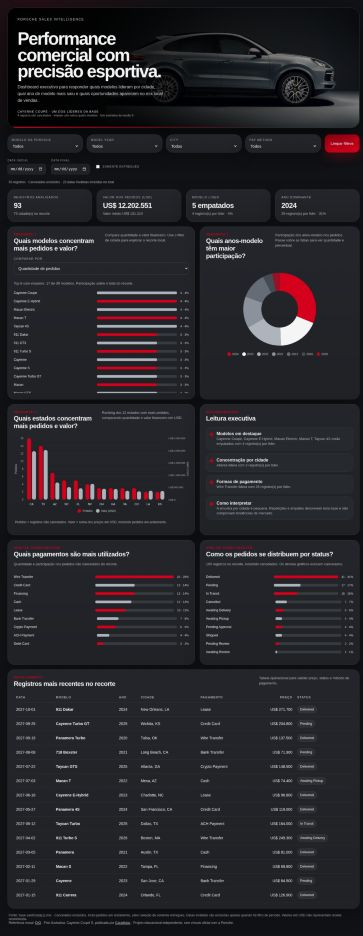
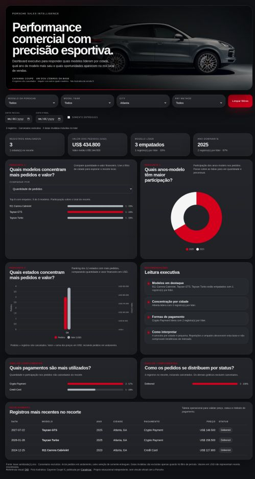

# Porsche Sales Dashboard

Dashboard interativo desenvolvido por **Camila Ribeiro** no contexto do bootcamp **Santander – Excel com IA e Claude**, da DIO. A análise usa exclusivamente os 100 registros da base fornecida e permite explorar modelos, anos-modelo, cidades e pagamentos.

**[Abrir a dashboard publicada](https://camisarp.github.io/porsche-sales-dashboard/)**

## Perguntas de negócio e escolhas dos gráficos

| Pergunta | Visual | Por que foi escolhida |
|---|---|---|
| Quais modelos concentram mais pedidos e valor financeiro? | Barras horizontais ordenadas, alternando quantidade e valor em USD | Permite comparar líderes de volume e de valor; o filtro de cidade revela o recorte local. O ranking inclui empates na última posição. |
| Quais anos-modelo têm maior participação nos pedidos? | Rosca com legenda e informações ao passar o mouse | Apresenta a composição por ano-modelo, com quantidade e participação. O formato foi escolhido durante os ajustes visuais. Ano-modelo não é ano da venda. |
| Quais estados concentram mais pedidos e valor financeiro? | Barras agrupadas com dois eixos identificados | Compara volume e soma dos valores por estado. As escalas são diferentes: alturas entre séries não devem ser comparadas diretamente. |

A comparação geográfica principal usa **estados** porque, entre os registros não cancelados, existem 73 cidades, das quais 54 aparecem apenas uma vez. Esse volume reduzido não sustenta conclusões sobre preferência de mercado por cidade.

Análises complementares: métodos de pagamento, status dos pedidos e leitura executiva calculada. Indicadores de topo: quantidade de registros, valor dos pedidos em USD, valor médio, modelo líder e ano-modelo líder.

## Como explorar

1. Acesse a dashboard e observe o total inicial de **93 pedidos não cancelados**.
2. Selecione **Atlanta** em **City**: o total passa a **3 registros**. Gráficos, indicadores e insights acompanham a seleção.
3. Em **Comparar por**, alterne entre quantidade e valor dos pedidos.
4. Combine Modelo da Porsche, Model Year, City, Pay method e período. Use **Somente entregues** quando quiser esse recorte.
5. Clique em **Limpar filtros** para retornar ao conjunto inicial.

## Base e tratamento dos dados

Fonte: arquivo fornecido `base sanitizada(1).xlsx`, aba `Sanitized`. O original foi preservado. A planilha já continha campos originais e campos sanitizados; esta etapa utilizou as colunas sanitizadas, sem atribuir à IA uma limpeza que já estava pronta.

| Campo utilizado | Finalidade |
|---|---|
| `sale_id` | Identificador do registro |
| `PorscheModelSanitized` | Modelo |
| `ModelYearSanitized` | Ano-modelo, convertido para inteiro |
| `CitySanitized` e `StateSanitized` | Localidade |
| `PayMethodSanitized` | Método de pagamento |
| `SaleDateSanitized` | Data válida em formato ISO ou ausência quando `INVALID` |
| `SalesPriceSanitized` | Valor convertido para número em USD |
| `DeliveryStatusSanitized` | Situação do pedido |

Verificações e regras:

- **100 registros e 100 identificadores distintos**, sem remoção de duplicatas por suposição.
- **7 cancelados** excluídos dos indicadores e gráficos principais, restando **93 registros**.
- O gráfico de **status inclui cancelados**, respeitando os outros filtros; sua população é informada junto ao gráfico. Com Somente entregues, mostra apenas os entregues.
- **41 registros com status Delivered** na base completa. Pedidos em andamento não são tratados como entregas concluídas.
- **24 datas marcadas INVALID**, preservadas como ausência. Não houve tentativa de adivinhar datas impossíveis ou ambíguas.
- Datas inválidas permanecem nas métricas sem filtro temporal; são excluídas quando uma data inicial ou final é aplicada. A quantidade é informada na interface.
- A base contém datas de **2024 a 2027**; esses registros são dados do exercício, não resultados oficiais atuais.
- Valores em **USD**, sem conversão para reais. “Valor dos pedidos” é soma dos preços dos registros elegíveis; não representa receita reconhecida. A média usa os mesmos pedidos do recorte.
- Métodos como Wire Transfer, Bank Transfer e ACH Payment foram mantidos distintos.
- Apenas campos necessários à análise são publicados. Nomes de clientes e vendedores não estão no HTML nem no JSON desta versão.

Os dados foram convertidos para JSON e incorporados ao HTML. `dados_sanitizados.json` mantém uma cópia dos campos analíticos para conferência; o site funciona sem carregar esse arquivo.

## Processo com IA: prompt e evolução

### Pedido inicial

> Utilizando o recurso de canvas, renderize uma dashboard em HTML ao lado. Inclua filtros por modelo da Porsche, Model Year, City e Pay method. Responda quais os principais modelos vendidos por cidade, qual ano-modelo teve maior saída em um período e apresente insights de vendas por cidade. Baseie o UI/UX no site oficial da Porsche Brasil, com um ar elegante e refinado.

### O que mudou até a versão final

1. A dashboard da [DIO](https://digitalinnovationone.github.io/dashboard_porsche_sales/) passou a ser referência de organização visual e componentes.
2. A distribuição por ano-modelo foi ajustada para rosca conforme referência enviada; a comparação geográfica principal passou para estados com quantidade e valor em dois eixos.
3. As perguntas foram refinadas após analisar a baixa quantidade de observações por cidade.
4. Foram acrescentados alternância de métrica no ranking de modelos, período, Somente entregues, pagamentos e status.
5. A foto do cabeçalho passou a representar o Cayenne Coupé, um dos cinco modelos empatados com 4 registros não cancelados. A foto ilustra uma versão S, não um veículo específico da base.
6. A paleta dourada da referência foi substituída por grafite, branco, vermelho e prata, dando identidade própria ao projeto.
7. O cabeçalho da tabela foi corrigido para manter títulos alinhados às colunas e permitir rolagem horizontal em telas menores.

### Prompt consolidado para reproduzir a direção final

> A partir da planilha fornecida, crie uma dashboard HTML/CSS/JavaScript em português, sem inventar dados. Prefira as colunas sanitizadas e preserve o original. Responda: quais modelos concentram mais pedidos e valor em USD; quais anos-modelo têm maior participação; e quais estados concentram mais pedidos e valor. Use barras horizontais com alternância de quantidade/valor para modelos, rosca para ano-modelo e barras agrupadas com dois eixos identificados para estados. Inclua filtros de modelo, ano-modelo, cidade, pagamento e período, Somente entregues e Limpar filtros. Acrescente cartões numéricos, análises de pagamento e status, insights com empates e tabela detalhada. Exclua cancelados das métricas principais; inclua-os no gráfico de status com definição explícita. Datas INVALID entram nos totais sem período e ficam fora de filtros temporais. Não confunda pedidos com vendas concluídas nem soma de preços com receita reconhecida. Use grafite #111215, cartões #202226, texto #F5F5F5, vermelho #D5001C e prata #AEB4BC. Inclua foto verificável do Cayenne Coupé e créditos. Entregue HTML autônomo, responsivo e sem CDN, pronto para GitHub Pages.

### Canvas ou agente com skill?

Foi usado o **ChatGPT para gerar e ajustar HTML/CSS/JavaScript**, seguido da aplicação da skill personalizada **Porsche Dashboard Assistant** para orientar análise e implementação. **Não foi utilizado o Canvas de código do ChatGPT**: o painel não estava disponível nesta sessão. A menção ao Canva não corresponde ao Canvas; o Canva não produziu esta dashboard. O resultado foi entregue como arquivo HTML executável no navegador.

## Identidade visual e tecnologia

| Aplicação | Cor |
|---|---|
| Fundo grafite | `#111215` |
| Cartões | `#202226` |
| Texto principal | `#F5F5F5` |
| Texto secundário | `#B6B8BD` |
| Destaque vermelho | `#D5001C` |
| Comparação em prata | `#AEB4BC` |
| Bordas | `#383B40` |

Tipografia declarada: Inter, Helvetica Neue e Arial, usando a primeira disponível no dispositivo. Não há download de fontes. Gráficos em SVG e HTML/CSS; fotografia incorporada ao arquivo; sem bibliotecas externas ou servidor de aplicação.

## Evidências de funcionamento

O teste automatizado executa a lógica JavaScript do HTML e verifica: total inicial de 93 pedidos, gráfico de status com 100 registros, filtros individuais, seleção combinada sem resultado, limpeza, alternância quantidade/valor, período com exclusão de datas inválidas e 41 entregues. É uma verificação funcional da lógica, não um teste de renderização.

Exemplo reproduzível: **City = Atlanta → 3 registros não cancelados**.

A versão publicada também foi aberta no navegador remoto. O filtro City = Atlanta foi aplicado e retornou 3 registros, valor total de US$ 434.800 e ano-modelo líder 2025.





## Estrutura e execução

```text
porsche-sales-dashboard/
├── index.html
├── dados_sanitizados.json
├── imagens/
│   ├── dashboard-geral.jpg
│   └── filtro-atlanta.jpg
├── testes/
│   └── dashboard.test.cjs
└── README.md
```

Execute a verificação funcional com `node testes/dashboard.test.cjs`.

Abra `index.html` em um navegador moderno ou utilize o endereço publicado. Para atualizar a base, refaça a extração dos campos sanitizados e a validação das regras; a dashboard não importa novas planilhas automaticamente.

Publicação: GitHub Pages, branch `main`, diretório raiz. O histórico anterior do repositório foi preservado.

## Créditos

Autoria do projeto: **Camila Ribeiro**. Contexto educacional: Santander e DIO. Referências: [Porsche Brasil](https://www.porsche.com/brazil/pt/) e dashboard da DIO. Fotografia ilustrativa do Cayenne Coupé S: [Caradisiac](https://www.caradisiac.com/porsche-cayenne-coupe-maintenant-en-s-de-440-ch-176344.htm); não integra a base de vendas nem representa uma unidade específica.

Projeto educacional independente, sem vínculo oficial com a Porsche. Os dados do exercício não permitem inferir participação de mercado, causalidade ou tendências da população.